# ✦ Self-Healing Predictive Network Using Digital Twin and Causal AI

**Research title:** *Digital Twin-Based Autonomous Network Failure Prediction and Self-Healing Framework Using Causal Artificial Intelligence*

A modular computer-network research project that combines telemetry, a synchronized digital twin, anomaly detection, failure prediction, causal root-cause analysis, counterfactual route evaluation, SDN recovery, closed-loop verification, and guarded continuous learning.

> **Evidence-first rule:** the dashboard distinguishes live Mininet/OVS observations from twin simulations. Unit-test success is not reported as a live network experiment, and simulated scale results are not reported as measured network performance.

---

## ✦ What the system does

```mermaid
flowchart LR
    A["Mininet / OVS\nEmulated network"] --> B["Telemetry\nPing + port counters"]
    B --> C["Digital twin\nState synchronization"]
    C --> D["Anomaly detection"]
    D --> E["Failure prediction"]
    E --> F["Causal root-cause analysis"]
    F --> G["Counterfactual twin"]
    G --> H["Recovery decision + trust gate"]
    H --> I["Ryu SDN controller"]
    I --> J["Closed-loop verification"]
    J --> B
    J --> K["Audit + evaluation evidence"]
    K --> L["Guarded continuous learning"]
    L --> E
```



### Research novelty and scope

- **Digital twin:** maintains a software representation of network topology and state.
- **Causal AI:** separates causal/intervention evidence from correlation-only signals; explanations must be evaluated against available evidence.
- **Predictive recovery:** evaluates an alternative action in the twin before network action is considered.
- **Self-healing SDN:** Ryu/OpenFlow and a redundant Mininet topology provide a controllable emulated network.
- **Trust layer:** validates telemetry and paths, gates recovery recommendations, and records security decisions.
- **Evaluation discipline:** reports only measured values and marks missing live experiments as pending.

Potential application domains include 5G, data centers, smart-city infrastructure, and defense networks. This repository is an academic emulation/research prototype, not a production deployment for safety-critical networks.

---

## 🧭 Phase map (1–16)

| Phase | Component | Repository location | Status / qualification |
|---:|---|---|---|
| 1 | Physical / Emulated Network | `sdn_controller/topologies/` | Mininet topology included |
| 2 | Advanced Network Telemetry | `telemetry/` | Ping and OVS telemetry included |
| 3 | Digital Twin Construction | `digital_twin/` | Network state and topology models included |
| 4 | Twin Synchronization Engine | `digital_twin/sync*` | Synchronization modules included |
| 5 | Network Anomaly Detection | `anomaly_detection/` | Statistical / threshold / ML components included |
| 6 | Failure Prediction Engine | `failure_prediction/` | Prediction models and features included |
| 7 | Causal AI & Root-Cause Engine | `causal_ai/` | Causal evidence and explanation modules included |
| 8 | Counterfactual Digital Twin | `digital_twin/counterfactual/` | Scenario simulation and feasibility checks included |
| 9 | Recovery Decision Engine | `failure_prediction/decision/` | Recovery policies and orchestration included |
| 10 | SDN Self-Healing Controller | `sdn_controller/self_healing_controller.py` | Ryu/OpenFlow controller included |
| 11 | Closed-Loop Verification | `reports/phase11_closed_loop_verification.md` | Recorded Mininet evidence included; recovery timing limitations documented |
| 12 | Continuous Learning | `failure_prediction/continuous_learning.py`, `failure_prediction/learning_trainer.py` | Feedback store and guarded candidate training; operational training remains gated until sufficient independently verified outcomes are approved |
| 13 | Security & Trust Layer | `security/` | Input/path validation, role policy, token helper, JSONL audit, controller/telemetry gates |
| 14 | Evaluation Framework | `evaluation/` | Classification and performance metric calculations; needs populated measured-trial CSV |
| 15 | Large-Scale Experiments | `experiments/` | Reproducible algorithmic graph-scale simulation; not a claim of large-scale Mininet runs |
| 16 | Final Test Cases & Results Validation | `validation/`, `reports/results/` | Automated software validation and live-test manifest; final live cases must be run and recorded |

### Current known limitations

- Phase 12 is deliberately guarded: `APPROVED_VERIFICATION_SOURCES` is empty until an evidence source is reviewed. The trainer must not learn from synthetic test rows or from labels derived from the same telemetry feature.
- The current Phase 14 framework is ready to calculate metrics, but an honest baseline-vs-proposed comparison requires independently labelled, repeated trials.
- Phase 15 produces algorithmic graph simulations. Its route-computation time is **not** network recovery time.
- Phase 16 distinguishes software tests from live Mininet tests. A final live result cannot be inferred from unit tests.
- Shared-token authentication in `security/trust_layer.py` is a local helper, not full OpenFlow TLS or enterprise identity management. Restrict the controller and dashboard to trusted local access.

---

## 🚀 Quick start

### 1. Environment

Run commands from the project root (any folder; paths are resolved relative to the project). The helper scripts in `scripts/` are written for Debian/Ubuntu. You can override the database path with `CN_TELEMETRY_DB`.

> **Running the final live demo?** Follow [`LIVE_DEMO_README.md`](LIVE_DEMO_README.md) — it has the setup, a pre-demo check (`bash scripts/check_env.sh`), the 7-minute run of show and troubleshooting.

Tests only need numpy/pandas/scikit-learn (Ryu is not required for them):

```bash
cd ~/cn_project        # your project root
python3 -m unittest discover -s tests -v
```

For the analytics/evaluation tools, install Python dependencies if they are missing:

```bash
python3 -m pip install -r requirements.txt
```

Mininet, Open vSwitch, and Ryu are system/environment dependencies and may need to be installed/configured separately. The commands below assume Mininet/OVS and the Ryu virtual environment are already working.

### 2. Launch the live demonstration

Use three terminals.

**Terminal 1 — Ryu controller**

```bash
cd ~/cn_project
$RYU_PY -m ryu.cmd.manager --observe-links sdn_controller/self_healing_controller.py
```

Keep this terminal open.

**Terminal 2 — Mininet redundant topology**

```bash
cd ~/cn_project
sudo mn -c
sudo env PYTHONPATH="$PWD" mn --custom sdn_controller/topologies/redundant_topology.py --topo redundant --controller remote,ip=127.0.0.1,port=6653 --switch ovs,protocols=OpenFlow13
```

At the `mininet>` prompt, test baseline connectivity:

```text
pingall
```

For the live link-failure demonstration:

```text
link s1 s2 down
pingall
```

Then restore the link:

```text
link s1 s2 up
pingall
```

Only call this a successful live test if the output and controller logs support it. The dashboard does not execute these commands for you.

**Terminal 3 — Sentinel Twin dashboard**

```bash
cd ~/cn_project
python3 demo/live_demo.py
```

Open **http://127.0.0.1:8765** in your browser.

The dashboard refreshes the SQLite telemetry and probes the actual OVS/Linux interface states. The four scenario buttons are clearly labelled **twin simulation only**; they do not change Mininet or claim to have executed a live recovery.

`$RYU_PY` is the Python of your Ryu environment (e.g. `export RYU_PY=$HOME/ryu-env/bin/python`). The same three steps are wrapped in `scripts/start_controller.sh`, `scripts/start_mininet.sh` and `scripts/start_dashboard.sh`.

---

## 🎬 Creative demo run of show (5–7 minutes)

1. **Normal network:** show live link status and the telemetry count. Select “Normal network” in the twin control room.
2. **Congestion:** select “Congestion” to demonstrate how a simulated telemetry deviation leads to a causal hypothesis and counterfactual evaluation. Explain that this scenario is simulated unless a traffic generator is running.
3. **Primary-link failure:** in the Mininet terminal run `link s1 s2 down`; show the actual interface status in the dashboard and run `pingall`. Keep live output as the evidence.
4. **Alternate route:** show Ryu's topology/path logs and confirm connectivity. A visually highlighted simulated route alone is not proof that live traffic traversed it.
5. **Recovery failure:** select the twin-only “Recovery failure / rollback” scenario to demonstrate the verification-and-rollback decision flow. Do not present it as a live rollback unless separately instrumented and measured.
6. **Restore:** run `link s1 s2 up` and `pingall`, then show the live topology return to its restored state.
7. **Trust and learning:** point out audit safeguards and the learning-readiness indicator. Explain that candidate training remains disabled until independently verified data meets the per-class threshold.

For a strong academic demonstration, capture terminal outputs, controller timestamps, raw telemetry, and trial IDs in addition to the dashboard.

---

## 🧪 Test and run commands

### Automated tests

```bash
python3 -m unittest discover -s tests -v
```

### Phase 13 — trust layer

```bash
python3 -m unittest tests.test_phase13_trust_layer tests.test_phase13_telemetry_guard -v
```

### Phase 14 — evaluation

Create a copy of `data/templates/evaluation_trials_template.csv`, fill it only with measured trials, then run:

```bash
python3 -m evaluation.framework --input data/my_evaluation_trials.csv
```

Important columns: `system` (baseline/proposed), `actual_failure`, `predicted_failure`, `prediction_lead_time_seconds`, `root_cause_correct`, `recovery_time_ms`, `packet_loss_percent`, `latency_ms`, `throughput_mbps`, `availability_percent`, `false_recovery`, `evidence_reference`.

### Phase 15 — algorithmic scale experiment

```bash
python3 -m experiments.large_scale --sizes 5,10,20,50,100 --repetitions 10
```

Results are written to `reports/results/phase15_scale_trials.csv` and `phase15_scale_summary.json`. These are graph-simulation outputs, not live Mininet measurements.

### Phase 16 — software validation manifest

```bash
python3 -m validation.final_validation
```

Writes `reports/results/phase16_validation_manifest.json` and `phase16_validation_report.md`. Live Mininet tests remain `NOT_RUN` until the experiment is executed and evidence recorded.

### Phase 12 — guarded learning

```bash
python3 -m failure_prediction.learning_trainer
```

Do not add a verification source to the trainer allowlist just to make it ready. Review how the outcome was independently established first.

---

## 📁 Project layout

```text
cn_project/
├── anomaly_detection/       # Baselines, detectors, feature preparation
├── causal_ai/               # Causal evidence and root-cause explanation
├── data/templates/          # Evaluation trial CSV template
├── demo/                    # Live telemetry + interactive twin dashboard
├── docs/                    # Short demo cheat-sheet
├── digital_twin/            # State, synchronization, counterfactual engine
├── evaluation/              # Phase 14 metric/report framework
├── experiments/             # Phase 15 graph-scale experiment harness
├── failure_prediction/      # Prediction, recovery, guarded learning
├── reports/                 # Phase 10–16 reports and evidence
├── sdn_controller/          # Ryu controller and Mininet topology
├── scripts/                 # Debian setup, pre-demo check, one-command launchers
├── security/                # Phase 13 trust and audit controls
├── telemetry/               # SQLite DB, ping and OVS telemetry
├── tests/                   # Unit and integration tests
├── validation/              # Phase 16 validation manifest
├── LIVE_DEMO_README.md      # Live demo run manual
├── README.md
├── requirements.txt
└── requirements-sdn.txt
```

---

## 🔬 Reporting and reproducibility rules

- Keep raw trial outputs, timestamped controller logs, and trial identifiers.
- Run baseline and proposed systems under the same topology, traffic profile, failure injection, and repetition count.
- Use independently verified labels for prediction metrics.
- Record unmeasured values as blank/`null`; do not fabricate throughput, recovery time, or availability.
- Distinguish algorithm runtime, twin-simulated outcome, and live network measurement.
- Never enable live model promotion without candidate evaluation, rollback capability, and approved verified feedback.

## Project identity

**Short name:** Sentinel Twin  
**Full name:** Self-Healing Predictive Network Using Digital Twin and Causal AI  
**Research title:** Digital Twin-Based Autonomous Network Failure Prediction and Self-Healing Framework Using Causal Artificial Intelligence
